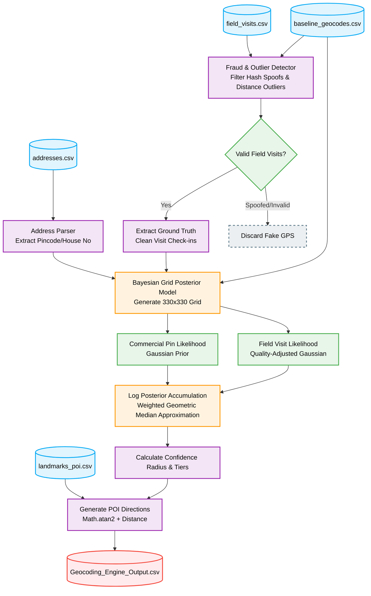

# CreditNirvana: Geocoding Engine

This repository contains the solution for an **Address Geocoder that Learns from Field Visits**. The engine computes a probabilistic location for each address by fusing commercial pin data, address text, and field visit GPS traces into a single Bayesian Grid Posterior model.

## Professional Repository Structure

```
.
├── backend/                  # FastAPI Application for the Dashboard
├── frontend/                 # Next.js React Dashboard
├── data/
│   ├── raw/                  # Original datasets
│   └── processed/            # Processed geocoded CSVs and output features
├── docs/                     # Reports, charts, and diagrams
├── notebooks/                # Exploratory Data Analysis
└── src/                      # Source code
    ├── data_processing/      # Scripts for data extraction
    ├── eda/                  # EDA and trends generators
    ├── models/               # Geocoder logic and modeling pipelines
    └── utils/                # Utility scripts
```

## Dashboard Application

A professional dashboard is provided to search for addresses, review their tiers, geocodes, confidence radius, and generated directions.

### Running the API Backend

Navigate to the `backend` directory, install requirements, and run the server:
```bash
cd backend
pip install -r requirements.txt
uvicorn main:app --reload
```
The API will run at `http://localhost:8000`.

### Running the Frontend Dashboard

Navigate to the `frontend` directory, install dependencies, and run the development server:
```bash
cd frontend
npm install
npm run dev
```
Open `http://localhost:3000` in your browser.

## Pipeline Architecture

Below is the workflow of the professional geocoding pipeline implemented in `src/models/geocoding_engine.py`:



## Output Features
The final pipeline fulfills all problem statement requirements by generating:
- **`x`, `y`**: The corrected location pin computed via the Bayesian Grid.
- **`confidence_radius`**: Confidence radius mathematically derived from check-in variance or global spread.
- **`tier`**: Visit priority classification (`A`: direct visit, `B`: visit with directions, `C`: verify first).
- **`directions`**: Computed using Cartesian distance and compass-angle (atan2) relative to nearest landmark POIs (e.g., `243m NE of Hanuman Temple`).
- **`address_text`**: The original full address for frontend display.
