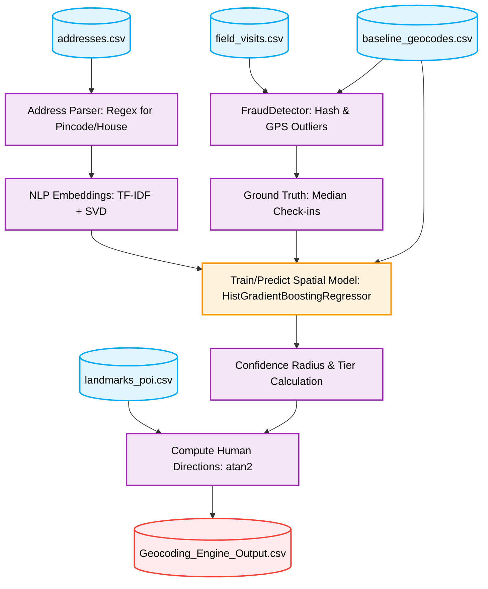

# Geocoding Engine: Pipeline Architecture & Detailed Methodology

This document details the complete end-to-end architecture for the **Address Geocoding Engine**, which learns from historical field visits to generate highly accurate spatial coordinates for user addresses.

## 1. Objective and Problem Statement

Commercial geocoding APIs (like Google Maps) often provide poor accuracy in rural or non-standardized urban areas. Addresses might contain local dialects, lack a formalized street name, or only reference localized landmarks. However, historical field visits (agents physically traveling to the address) provide high-quality GPS breadcrumbs and check-in locations. 

The objective of this pipeline is to use an **ML-based Spatial Interpolation Model** to correct baseline commercial geocodes by learning the relationship between the address text (and structured features) and the residual error (delta X, delta Y) against verified field visit check-ins.

---

## 2. Dataset and Features

The dataset comprises multiple sources integrated to form the learning base.

### 2.1 Core Datasets
- **`addresses.csv`**: Contains the raw text of the address, town IDs, and address types (Residence/Office).
- **`baseline_geocodes.csv`**: Contains the commercial vendor’s estimated coordinates (`geocoder_x`, `geocoder_y`).
- **`field_visits.csv`**: Contains agent visits, outcomes, `checkin_x`, `checkin_y`, and a `photo_hash` of the verification photo.
- **`landmarks_poi.csv`**: Contains coordinates and types of Points of Interest (POIs) used to generate final human-readable directions.

### 2.2 Feature Engineering (Data Creation)
The pipeline engineered several critical features out of the raw datasets:

- **Parsed Address Attributes**: The raw address text is passed through the `AddressParser`, utilizing Regular Expressions (Regex) to extract the **Pincode** (e.g., matching a 6-digit number) and the **House/Flat Number** (e.g., matching "H.No", "Flat", "Plot").
- **Categorical Encodings**: `LabelEncoder` translates `town_id`, `address_type`, and the newly `parsed_pincode` into categorical features (`town_enc`, `type_enc`, `pin_enc`).
- **NLP Text Embeddings (TF-IDF + SVD)**: 
  - To capture the spatial semantic meaning within the raw, localized `address_text` (such as "opposite the banyan tree" or "gali number 4"), the pipeline applies Natural Language Processing.
  - **TF-IDF**: Extracts up to 500 token features using `TfidfVectorizer`, disregarding standard English stopwords.
  - **Dimensionality Reduction**: A `TruncatedSVD` isolates the top 10 latent semantic components (`embed_0` to `embed_9`), drastically reducing noise and providing dense vector representations to the ML model.

---

## 3. The Pipeline Architecture

The pipeline orchestrated in `src/models/geocoding_engine.py` operates in 6 sequential phases.

### Phase 1: Address Parsing
Raw addresses are scanned to extract structural features (`parsed_pincode`, `parsed_house_no`).

### Phase 2: Fraud & Outlier Detection
We filter out invalid or spoofed field visits:
- **Photo Hash Duplication (Spoofing)**: If an agent reuses the exact same photograph (`photo_hash`) across multiple visits, these visits are flagged as fraudulent and discarded.
- **GPS Teleportation (Outliers)**: If the agent’s check-in coordinate (`checkin_x`, `checkin_y`) is implausibly distant (e.g., > 1500m) from the commercial baseline, it is considered a noisy or spoofed GPS artifact and dropped.
- **Outcome Filtering**: Only visits with verifiable outcomes (e.g., `met_borrower`, `locked_premises`, `cash_collected`) are retained.

### Phase 3: Ground Truth Extraction
For addresses with multiple valid visits, the check-in coordinates are aggregated using a **median** function. This robustly isolates the true coordinate, immune to single-visit GPS jitter.

### Phase 4: Spatial ML Interpolation Model
*Specifically, we use the `HistGradientBoostingRegressor` (or alternatively Random Forest / K-Nearest Neighbors).*

**Why HistGradientBoostingRegressor?**
It natively handles categorical encodings, is extremely fast on tabular data, and accurately captures non-linear relationships between the text embeddings and the spatial grid.

- **Target Variables**: The model learns two separate targets:
  - `delta_x = checkin_x - geocoder_x`
  - `delta_y = checkin_y - geocoder_y`
- **Training**: The model is trained *only* on addresses that have verified field visits.
- **Inference**: The trained model predicts the residual corrections (`delta_x`, `delta_y`) for addresses *without* field visits based on their NLP embeddings, town, and pincode.
- **Final Coordinate Calculation**: 
  - If a valid field visit exists -> `final_x = checkin_x`
  - If no visit exists -> `final_x = geocoder_x + predicted_delta_x`

### Phase 5: Confidence Radius & Tiers
- Computes a dynamic `confidence_radius` based on the density of the town cluster or variance among historical visits.
- Categorizes addresses into operational **Tiers**:
  - `Tier A`: Direct visit available (High precision).
  - `Tier B`: Visit available with nearby landmark directions.
  - `Tier C`: No visit history; model-predicted coordinate; Verification highly recommended.

### Phase 6: Human-Readable Directions
Using standard Cartesian mathematics (`math.atan2`) and euclidean distances against `landmarks_poi.csv`, the engine translates the final (x, y) coordinate into an agent-friendly instruction (e.g., "150m NE of Primary School").

---

## 4. Visual Flowchart

